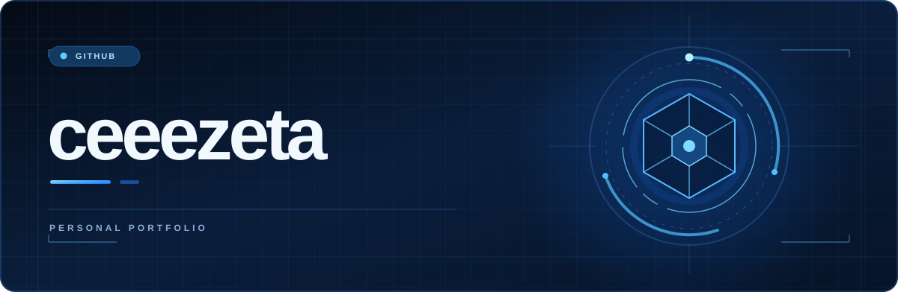
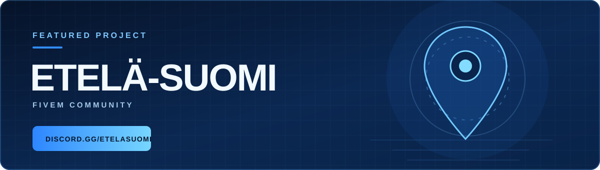

 
 

 
 

 

## 01 &nbsp; / &nbsp; About

I'm a **20-year-old ICT Engineer & Software Engineer** who enjoys turning ideas into polished digital experiences. I work across frontend, backend and systems, with an eye for clean interfaces, maintainable architecture and the details that make software feel great to use.

<table>
<tr>
<td width="33%" valign="top">

**🎨 &nbsp; Interfaces**

Modern UI, responsive layouts and thoughtful interaction design.

</td>
<td width="33%" valign="top">

**⚙️ &nbsp; Engineering**

Practical applications, tooling, APIs and reliable systems.

</td>
<td width="33%" valign="top">

**🛡️ &nbsp; Security**

An interest in web, application, network and system security.

</td>
</tr>
</table>

 

## 02 &nbsp; / &nbsp; Technology stack

**Languages & web**

  

**Frameworks & runtime**

  

**Tools & infrastructure**

 

## 03 &nbsp; / &nbsp; Featured project

 

**Etelä-Suomi** is a FiveM project and community. Discover the project and connect with the community through Discord.

 
 

 

## 04 &nbsp; / &nbsp; GitHub activity

  

 

## 05 &nbsp; / &nbsp; What I'm into

 

